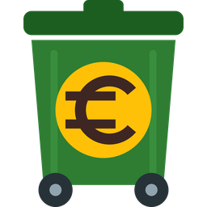
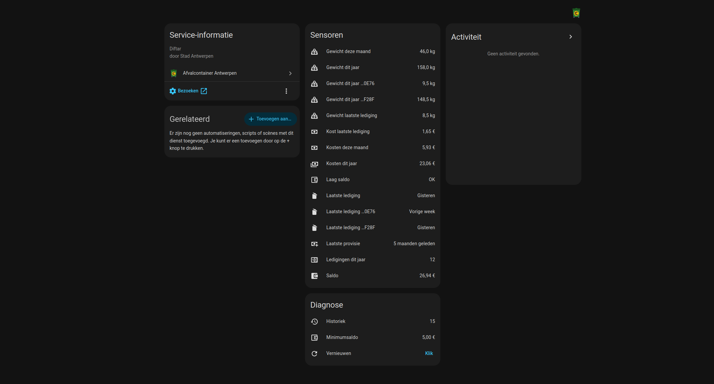
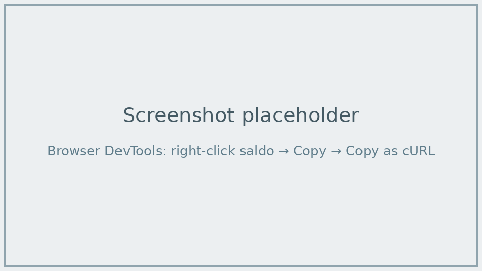
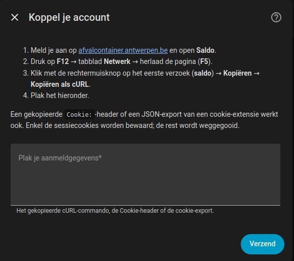
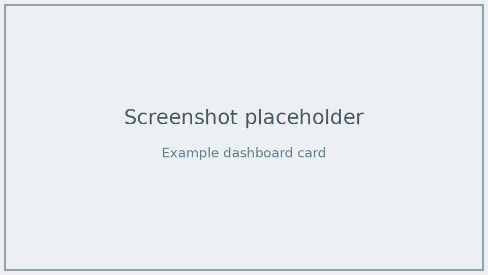

# Afvalcontainer Antwerpen for Home Assistant

[](https://hacs.xyz/)
[](https://github.com/DRYTRIX/ha-afvalcontainer-antwerpen/actions/workflows/validate.yml)
[](https://github.com/DRYTRIX/ha-afvalcontainer-antwerpen/actions/workflows/tests.yml)

Shows the **diftar balance** and **emptying history** of your weighed residual-waste
container(s) from [afvalcontainer.antwerpen.be](https://afvalcontainer.antwerpen.be/mijn-containers/saldo)
in Home Assistant: balance, a low-balance alert, the last emptying with weight and cost,
weight and cost totals per month and year, and events you can automate on
("container emptied: 8.5 kg, € 1.65").

Setup happens entirely in the UI. No YAML is needed.



> [!WARNING]
> **Unofficial.** This integration is not made, supported or endorsed by Stad Antwerpen or
> Digipolis. There is no public API: the integration reads the same pages your browser does,
> so it **may break when the website changes**. Do not contact the city about this integration.

## Contents

- [What you get](#what-you-get)
- [Installation](#installation)
- [Get your login data](#get-your-login-data)
- [Configuration](#configuration)
- [Entities](#entities)
- [Events and automations](#events-and-automations)
- [Dashboard example](#dashboard-example)
- [Troubleshooting](#troubleshooting)
- [Privacy](#privacy)
- [Development](#development)

## What you get

- One device per account, with balance, minimum balance and a low-balance problem sensor
- Last emptying (date, weight, cost), totals for this month and this year, number of emptyings
- Last top-up ("provisie") and a diagnostic history sensor
- Per-container sensors when your account has more than one container
- Events `afvalcontainer_antwerpen_new_emptying` / `afvalcontainer_antwerpen_new_topup`, also
  available as **device triggers** ("When a new emptying is registered")
- A refresh button, diagnostics download (personal data redacted), Dutch and English UI

## Installation

### HACS (recommended)

1. Click this button to add the repository to HACS:

   [](https://my.home-assistant.io/redirect/hacs_repository/?owner=DRYTRIX&repository=ha-afvalcontainer-antwerpen&category=integration)

   Or add it by hand: HACS → ⋮ → **Custom repositories** → URL
   `https://github.com/DRYTRIX/ha-afvalcontainer-antwerpen`, type **Integration**.
2. Search for **Afvalcontainer Antwerpen** in HACS and click **Download**.
3. **Restart Home Assistant.**
4. Add the integration:

   [](https://my.home-assistant.io/redirect/config_flow_start/?domain=afvalcontainer_antwerpen)

   Or go to Settings → Devices & services → **Add integration** → "Afvalcontainer Antwerpen".

Requires Home Assistant **2026.3** or newer.

### Manual

Copy `custom_components/afvalcontainer_antwerpen` into the `custom_components` folder of
your Home Assistant configuration and restart.

## Get your login data

The city's login (A-profiel) only offers itsme, eID or a code from the federal app or by SMS,
so Home Assistant cannot log in for you (see [docs/auth-research.md](docs/auth-research.md)).
Instead you log in once in your browser and paste the session into Home Assistant. It takes
about a minute.



### Chrome / Edge / Brave

1. Open <https://afvalcontainer.antwerpen.be/mijn-containers/saldo> and log in. You should see
   your balance.
2. Press **F12** (Mac: **⌥⌘I**) and open the **Network** tab.
3. Reload the page (**F5**).
4. Right-click the first request, called **saldo** → **Copy** → **Copy as cURL (bash)**.
   On Windows "Copy as cURL (cmd)" and "Copy as PowerShell" work too.
5. Paste it into the **Paste your login data** field in Home Assistant.

### Firefox

1. Log in and open the **Saldo** page as above.
2. Press **F12** (Mac: **⌥⌘I**), open **Network**, reload the page.
3. Right-click the **saldo** request → **Copy Value** → **Copy as cURL**
   (or **Copy Request Headers**; both work).
4. Paste into Home Assistant.

### Safari (Mac)

1. Enable the developer tools once: Safari → **Settings** → **Advanced** →
   **Show features for web developers**.
2. Log in and open the **Saldo** page.
3. **Develop** → **Show Web Inspector** → **Network** tab, reload the page.
4. Select the **saldo** request. In **Headers** → **Request**, copy the whole `Cookie:` line,
   or right-click the request → **Copy as cURL**.
5. Paste into Home Assistant.

### Alternatives that also work

- Just the `Cookie:` header value (`afvalcontainers-antwerpen-session=…; XSRF-TOKEN=…`)
- A JSON export from a cookie-editor browser extension, or a `cookies.txt` file

Whatever you paste, the integration keeps only `afvalcontainers-antwerpen-session`,
`XSRF-TOKEN` and the A-profiel SSO cookies (`dgp.auth.ssokey`, `KEYCLOAK_*`,
`AUTH_SESSION_ID`). Everything else is thrown away before anything is stored.



## Configuration

**Settings → Devices & services → Afvalcontainer Antwerpen → Configure**:

| Option | Default | Notes |
|---|---|---|
| Update interval | 30 min | 10–90 min. Polling also keeps the 2-hour website session alive, so the maximum is 90. |
| Low balance threshold | site minimum | Empty = use the minimum balance from the site (e.g. € 5). Set e.g. € 10 to be warned earlier. |

**Reconfigure** (⋮ menu) lets you paste new login data at any time.

## Entities

Entity IDs start with `sensor.afvalcontainer_antwerpen_<first name>_…`.

| Entity | Type | Unit | Notes |
|---|---|---|---|
| Balance | sensor (monetary, total) | € | Attribute `invoices_url`: where you top up / see payments |
| Minimum balance | sensor (diagnostic) | € | Minimum required by the city |
| Low balance | binary sensor (problem) | | On when balance < threshold; attributes `threshold`, `balance` |
| Last emptying | sensor (timestamp) | | Local midnight of the emptying date; attributes `weight_kg`, `cost_eur`, `container` |
| Last emptying weight | sensor (weight) | kg | |
| Last emptying cost | sensor (monetary) | € | |
| Weight this year / this month | sensor (weight, total) | kg | Resets on 1 January / the 1st (`last_reset`) |
| Cost this year / this month | sensor (monetary, total) | € | Sum of emptying costs |
| Emptyings this year | sensor (total) | | Count |
| Last top-up | sensor (timestamp) | | Attribute `amount_eur` |
| History | sensor (diagnostic) | | Number of history rows; attribute `rows` = last 20 rows (not recorded in history) |
| Last emptying ‹container› | sensor (timestamp) | | Only with 2+ containers |
| Weight this year ‹container› | sensor (weight, total) | kg | Only with 2+ containers |
| Refresh | button (diagnostic) | | Fetch now |

Containers are labelled with fraction/volume when the site provides them, otherwise
with the last 4 digits of the container number (e.g. `…0001`).

## Events and automations

When a new history row appears, the integration fires an event **once** (existing history is
not announced at setup, and restarts don't repeat events):

| Event | When | Data |
|---|---|---|
| `afvalcontainer_antwerpen_new_emptying` | a new emptying ("Lediging") | `id`, `date`, `service`, `service_label`, `weight_kg`, `amount_eur`, `cost_eur`, `container`, `location`, `order_id`, `balance_eur`, `device_id`, `config_entry_id` |
| `afvalcontainer_antwerpen_new_topup` | a new top-up ("Provisie") | same fields |

In the automation editor you can use these as **device triggers**: *Device → Afvalcontainer
Antwerpen → "New emptying registered"*.

### Notify when the balance is low

```yaml
alias: Afvalcontainer saldo laag
triggers:
  - trigger: state
    entity_id: binary_sensor.afvalcontainer_antwerpen_jan_low_balance
    to: "on"
actions:
  - action: notify.mobile_app_my_phone
    data:
      title: Afvalcontainer
      message: >
        Saldo is € {{ states('sensor.afvalcontainer_antwerpen_jan_balance') }}.
        Vul aan via {{ state_attr('sensor.afvalcontainer_antwerpen_jan_balance', 'invoices_url') }}
```

### Notify when the container was emptied

```yaml
alias: Afvalcontainer geledigd
triggers:
  - trigger: event
    event_type: afvalcontainer_antwerpen_new_emptying
actions:
  - action: notify.mobile_app_my_phone
    data:
      title: Container geledigd
      message: >
        {{ trigger.event.data.weight_kg }} kg, € {{ '%.2f' | format(trigger.event.data.cost_eur) }}.
        Saldo: € {{ trigger.event.data.balance_eur }}
```

## Dashboard example



```yaml
type: vertical-stack
cards:
  - type: entities
    title: Afvalcontainer
    entities:
      - entity: sensor.afvalcontainer_antwerpen_jan_balance
        name: Saldo
      - entity: binary_sensor.afvalcontainer_antwerpen_jan_low_balance
        name: Saldo laag
      - entity: sensor.afvalcontainer_antwerpen_jan_last_emptying
        name: Laatste lediging
        format: date
      - entity: sensor.afvalcontainer_antwerpen_jan_last_emptying_weight
        name: Gewicht
      - entity: sensor.afvalcontainer_antwerpen_jan_weight_this_year
        name: Gewicht dit jaar
      - entity: sensor.afvalcontainer_antwerpen_jan_cost_this_year
        name: Kosten dit jaar
  - type: statistics-graph
    title: Saldo
    entities:
      - sensor.afvalcontainer_antwerpen_jan_balance
    stat_types: [mean]
    period: week
    days_to_show: 90
```

## Troubleshooting

**"Re-authentication required"**: the website session ended. Click **Reconfigure** /
**Re-authenticate** in the repair or on the integration, and paste fresh login data the same
way as during setup.

**How often will I need to re-paste?** The website session lasts 2 hours and is extended on
every update, so as long as Home Assistant keeps running it stays alive. You'll need to
re-paste when:

- Home Assistant was **off or offline for more than ~2 hours** (updates, power cut),
- the website itself ended the session (logout, maintenance, site changes),
- you clicked **Afmelden** (log out) on the website: logging out also kills the session HA uses.
  Just close the tab instead.

Before asking you, the integration tries a silent re-login through the A-profiel SSO. That
only works if you pasted the SSO cookies too and that SSO session is still valid, which is
usually not the case after a long outage.

**"No afvalcontainer session cookie found"**: you copied a different request or weren't
logged in. Copy the **saldo** request from the Network tab after the balance is visible.

**"Could not read the balance page"**: the website probably changed. Please open an issue
with the [diagnostics](#privacy) file attached.

**Debug logging**: Settings → Devices & services → Afvalcontainer Antwerpen → ⋮ →
**Enable debug logging**.

## Privacy

- Your cookies are stored **only** in Home Assistant's config entry storage
  (`.storage/core.config_entries`), like the credentials of any other integration.
  Only the needed cookies are kept.
- Home Assistant only talks to `afvalcontainer.antwerpen.be` (and, for the silent re-login,
  `authentication.antwerpen.be`). **Nothing is sent anywhere else**, and the integration only
  reads pages (no `POST` requests, no payments, no changes to your account).
- The account is identified by a one-way hash of your e-mail address. The address itself is
  not stored.
- **Download diagnostics** redacts cookies, names, e-mail, phone, addresses, container
  numbers and order IDs, so the file is safe to attach to an issue.

## Development

See [CONTRIBUTING.md](CONTRIBUTING.md). `scripts/develop --fake` runs a dev Home Assistant
against a local fake of the website, so you don't need an account.

## License

[MIT](LICENSE). Not affiliated with Stad Antwerpen, Digipolis or Home Assistant.
